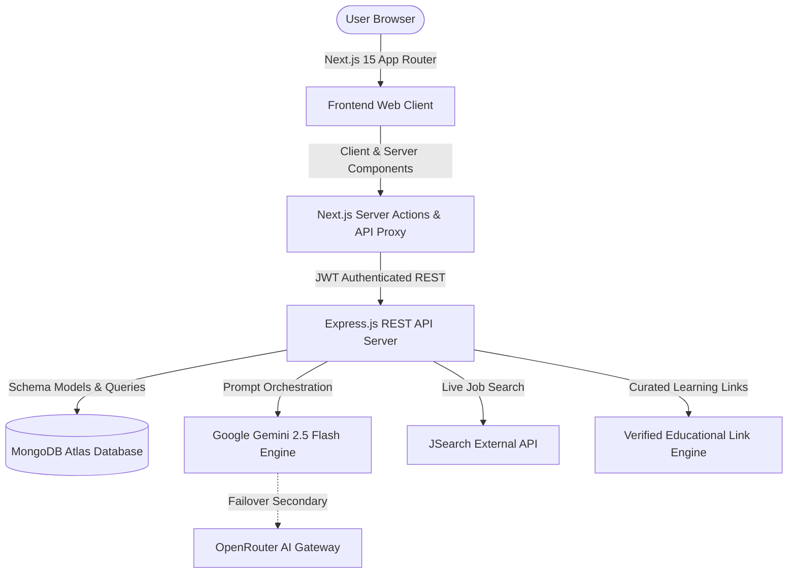

# 🚀 CareerSync — AI-Powered Career Operating System

> **An end-to-end career intelligence and acceleration platform** that bridges the gap between where you are and where you want to be. CareerSync analyzes your resume, detects your real-world skill gaps, generates personalized visual roadmaps, crafts bespoke on-demand courses, runs adaptive diagnostic assessments, and matches you directly with live job opportunities.

[](https://career-syncai.vercel.app/home)
[](https://nextjs.org/)
[](https://expressjs.com/)
[](https://www.mongodb.com/atlas)
[](https://deepmind.google/technologies/gemini/)

---

## 📌 Table of Contents
- [What is CareerSync?](#-what-is-careersync)
- [The Problem It Solves](#-the-problem-it-solves)
- [Core Platform Modules](#-core-platform-modules)
- [The End-to-End User Journey](#-the-end-to-end-user-journey)
- [System Architecture](#-system-architecture)
- [Technology Stack](#-technology-stack)
- [Repository Structure](#-repository-structure)
- [Getting Started Locally](#-getting-started-locally)
- [Core API Reference](#-core-api-reference)
- [Deployment Guide](#-deployment-guide)

---

## 💡 What is CareerSync?

CareerSync is a modern, full-stack career acceleration platform. Instead of forcing learners to navigate disjointed tools—using one app for job hunting, another for video tutorials, another for resume reviews, and spreadsheets for roadmaps—CareerSync unifies the entire career transition lifecycle into a single, cohesive workflow.

Whether you are an aspiring software engineer, an artist, a product manager, or a career switcher, CareerSync acts as your personal AI career advisor. It figures out what you already know, identifies what you need to learn, builds you a tailored learning path, and helps you land the job.

---

## 🎯 The Problem It Solves

1. **Generic Learning Paths**: Most online learning platforms offer fixed, one-size-fits-all video playlists that ignore a student's prior background, specific timeframe, and individual goals.
2. **The Resume "Black Box"**: Candidates submit hundreds of resumes without understanding how their current skillset maps against real employer requirements.
3. **Skill Verification Gap**: Watching video tutorials does not prove competency. Learners need adaptive testing to validate their practical knowledge.
4. **Disconnected Job Applications**: Job seekers look at generic job boards that have zero connection to the skills they just mastered.

**CareerSync connects all of these dots into a closed-loop system.**

---

## 🧩 Core Platform Modules

### 1. 📄 Resume Intelligence & Skill Gap Profiling
- Upload your resume in PDF or Word format.
- The extraction engine parses your work history, verified skills, and project experience.
- Compare your current profile against target industry roles (e.g., Full Stack Engineer, Cloud Architect, UX Designer) to instantly pinpoint missing skills and areas for improvement.

### 2. 🗺️ Interactive Career Roadmaps
- Generate a dynamic, visual step-by-step career progression map tailored to your specific target role.
- Filter milestones across **Foundational**, **Intermediate**, and **Mastery** stages.
- Interactive step-by-step checklists let you track your progress over time with persistent status saving.
- Export clean, high-contrast PDF roadmaps to share with mentors or study offline.

### 3. 🎓 Universal Course Generator
- Enter **any topic or discipline** (from *Docker Containerization* and *System Design* to *Renaissance Oil Painting*, *Organic Gardening*, or *Spoken Spanish*).
- An interactive onboarding wizard asks 4 to 5 topic-specific questions to calibrate your experience level, daily time commitment, and goals.
- The AI curriculum engine builds a complete, multi-module course with:
  - Domain-authentic module titles and detailed lesson overviews.
  - Hands-on practical assignments and milestone projects.
  - Verified, working educational resources (Wikipedia references, curated YouTube video lessons, and reading guides).

### 4. 📝 Adaptive Skill Assessments
- Take calibrated diagnostic tests for any skill or generated course.
- Questions dynamically adjust to your experience level with immediate feedback, detailed scorecards, and explanations.
- Tracks historical assessment scores on your dashboard to visualize growth over time.

### 5. 💼 Real-Time Job Discovery & Match Scoring
- Live job market integration powered by the JSearch API.
- Search real-world job openings filtered by role, location, remote preferences, and job type.
- Each listing displays an intelligent match percentage computed by comparing your verified profile skills against employer requirements.

---

## 🔄 The End-to-End User Journey

```
[1. Sign Up & Profile Setup]
             │
             ▼
[2. Upload Resume / Select Target Role]
             │
             ▼
[3. Automated Skill-Gap Analysis] ──► Identifies what skills you are missing
             │
             ▼
[4. Interactive Career Roadmap]  ──► Visualizes your step-by-step milestone path
             │
             ▼
[5. Generate Custom Courses]    ──► Builds complete personalized curricula for gap areas
             │
             ▼
[6. Take Skill Assessments]      ──► Validates your mastery with interactive scoring
             │
             ▼
[7. Job Discovery & Matching]    ──► Apply directly to live roles matching your new skills
```

---

## 🏛️ System Architecture

CareerSync is architected as an enterprise-grade monorepo with clean separation between the edge-rendered frontend client and the backend application service layer.



### Architectural Highlights
- **Decoupled Monorepo**: Independent `apps/web` (Frontend) and `apps/api` (Backend) packages sharing unified workspace tooling and npm scripts.
- **Dual-Layer Authentication**: Secure HttpOnly cookies for desktop browsers with seamless `Authorization: Bearer` token synchronization for third-party privacy sandboxes (iOS / Safari).
- **Multi-Provider AI Resilience**: Primary prompt processing through **Google Gemini 2.5 Flash** for sub-30 second multi-module synthesis, with automatic failover to OpenRouter.
- **Self-Healing Data Pipelines**: Embedded `jsonrepair` parser ensures that unexpected AI formatting quirks never crash user requests.

---

## 🛠️ Technology Stack

| Domain | Technology | Purpose |
| :--- | :--- | :--- |
| **Frontend Framework** | **Next.js 15 (App Router)** | High-performance React framework with server-side rendering and edge optimizations. |
| **Client Library** | **React 18** | Modular component UI architecture. |
| **Styling & Tokens** | **Tailwind CSS** | Minimalist black-and-white design system with consistent typography and layout tokens. |
| **Icons & Primitives** | **Lucide React + Radix UI** | Accessible, accessible UI controls, modals, and iconography. |
| **Backend Runtime** | **Node.js (ESM)** | Fast, asynchronous JavaScript runtime. |
| **API Framework** | **Express.js 5** | RESTful routing, middleware pipeline, and request validation. |
| **Database** | **MongoDB Atlas & Mongoose** | Cloud NoSQL database with schema validation and indexing. |
| **Primary AI Engine** | **Google Gemini 2.5 Flash** | High-speed, multimodal LLM for curriculum design and question generation. |
| **Secondary AI** | **OpenRouter (Mixtral 8x22B)** | Resilient backup AI gateway. |
| **Job Market Data** | **JSearch API (RapidAPI)** | Aggregated live job postings from LinkedIn, Indeed, Glassdoor, etc. |
| **Frontend Hosting** | **Vercel** | Global edge deployment with automatic SSL and continuous integration. |
| **Backend Hosting** | **Render** | Managed cloud container web service. |

---

## 📁 Repository Structure

```
Career Sync/
├── apps/
│   ├── api/                          # Express.js REST API Server
│   │   ├── config/                   # Target roles, CORS origins, and system configurations
│   │   ├── db/                       # MongoDB connection & Mongoose lifecycle management
│   │   ├── middleware/               # Auth guards, request validation, rate limiting, security
│   │   ├── models/                   # Database schemas (User, Course, Roadmap, SkillGap, etc.)
│   │   ├── routes/                   # REST API routes (auth, roadmaps, courses, resume, skills)
│   │   ├── services/                 # Business logic for AI synthesis, ATS scoring, emails
│   │   ├── utils/                    # Structured logging, token utilities, device detectors
│   │   ├── package.json              # Backend dependencies
│   │   └── server.js                 # Express server initialization
│   │
│   └── web/                          # Next.js 15 Web Application
│       ├── app/                      # App Router directory
│       │   ├── (app)/                # Protected workspace routes:
│       │   │   ├── home/             # Main application dashboard
│       │   │   ├── roadmaps/         # Interactive roadmap viewer
│       │   │   ├── courses/          # Course generator entry point
│       │   │   ├── assessments/      # Adaptive skill testing interface
│       │   │   ├── career/           # Job discovery and matching interface
│       │   │   ├── profile/          # Resume management & talent profile
│       │   │   └── settings/         # User preferences and security
│       │   ├── (marketing)/          # Public landing, sign-up, and login pages
│       │   └── api/                  # Server-side API proxy handlers
│       ├── components/               # Reusable UI component library
│       ├── contexts/                 # React Contexts (Authentication & Session sync)
│       ├── lib/                      # API client, utility functions, type definitions
│       ├── middleware.ts             # Route protection & edge session redirector
│       └── tailwind.config.ts        # Design tokens & color system
│
├── docs/                             # Engineering & Quality Documentation
│   ├── BACKUP_AND_RECOVERY.md        # Disaster recovery procedures, RPO/RTO
│   ├── ERROR_HANDLING_AND_LOGGING.md # Centralized logging guidelines
│   ├── SECURITY_AUDIT.md             # Security audit and mitigation report
│   └── QUALITY_AUDIT.md              # UI/UX and accessibility quality audit
│
├── scripts/                          # Operational & administrative CLI utilities
├── deploy.js                         # Local development multi-process runner
├── DEPLOYMENT_GUIDE.md               # Step-by-step production deployment guide
├── render.yaml                       # Infrastructure-as-Code Blueprint for Render
├── package.json                      # Monorepo root workspace configuration
└── .gitignore                        # Hardened git ignore specifications
```

---

## 💻 Getting Started Locally

### Prerequisites
- **Node.js**: v20 or newer (`node -v`)
- **npm**: v10 or newer (`npm -v`)
- **MongoDB**: A free MongoDB Atlas cluster URI or a local instance (`mongodb://localhost:27017/CareerOs`)
- **Google Gemini API Key**: Obtain a free API key from [Google AI Studio](https://aistudio.google.com/)

---

### Step 1: Clone the Repository
```bash
git clone https://github.com/HarishBonu0/Career_Sync.git
cd Career_Sync
```

### Step 2: Install All Dependencies
Install root, backend, and frontend dependencies in one command:
```bash
npm run install:all
```

### Step 3: Configure Environment Variables

Create the `.env` file for the backend:
```bash
# In apps/api/.env
PORT=5000
NODE_ENV=development
JWT_SECRET=your-random-32-character-secret-key
MONGODB_URI=mongodb+srv://<username>:<password>@cluster.mongodb.net/CareerOs?retryWrites=true&w=majority
GEMINI_API_KEY=your_gemini_api_key_here
CORS_ORIGINS=http://localhost:3000
FRONTEND_URL=http://localhost:3000
```

Create the `.env.local` file for the frontend:
```bash
# In apps/web/.env.local
NEXT_PUBLIC_API_URL=http://localhost:5000/api
NEXT_PUBLIC_API_BASE_URL=http://localhost:5000/api
GEMINI_API_KEY=your_gemini_api_key_here
OPENROUTER_API_KEY=your_optional_openrouter_key
```

### Step 4: Start the Development Servers
Start both the Next.js frontend and Express backend concurrently:
```bash
npm run dev
```

The terminal will report active ports:
- **Frontend App**: [http://localhost:3000](http://localhost:3000)
- **Backend API**: [http://localhost:5000](http://localhost:5000)
- **API Health Check**: [http://localhost:5000/api/health](http://localhost:5000/api/health)

---

## 📡 Core API Reference

| Endpoint | Method | Description | Authentication |
| :--- | :--- | :--- | :---: |
| `/api/health` | `GET` | Health check, MongoDB connection status, server uptime | Public |
| `/api/auth/register` | `POST` | Register a new user with secure password hashing | Public |
| `/api/auth/login` | `POST` | Authenticate user credentials & issue JWT session | Public |
| `/api/auth/me` | `GET` | Fetch authenticated user profile data | Required |
| `/api/courses/generate-questions` | `POST` | Dynamic wizard question generation for any topic | Public |
| `/api/generate-course` | `POST` | Generate full multi-module curriculum with verified resources | Optional |
| `/api/courses` | `GET` | List saved courses, enrollments, and progress metrics | Required |
| `/api/roadmaps/generate` | `POST` | Synthesize milestone-based career roadmap for target role | Required |
| `/api/roadmaps` | `GET` | List user's saved career roadmaps | Required |
| `/api/resume/analyze` | `POST` | Upload and parse resume document (PDF/DOCX) | Required |
| `/api/skills/questions` | `POST` | Generate adaptive skill assessment challenge | Required |
| `/api/skills/evaluate` | `POST` | Submit assessment answers and compute skill score | Required |

---

## 🚢 Deployment Guide

CareerSync is configured for high-performance decoupled hosting:
- **Frontend (Next.js)** ➔ **[Vercel](https://vercel.com/)**
- **Backend (Express)** ➔ **[Render](https://render.com/)**
- **Database** ➔ **[MongoDB Atlas](https://www.mongodb.com/atlas)**

For detailed production configuration, custom domain setup, CORS linking, and environment variable configuration, refer to the [DEPLOYMENT_GUIDE.md](./DEPLOYMENT_GUIDE.md).

---

## 📄 License

This project is licensed under the ISC License. Built with passion to empower modern careers through artificial intelligence.
