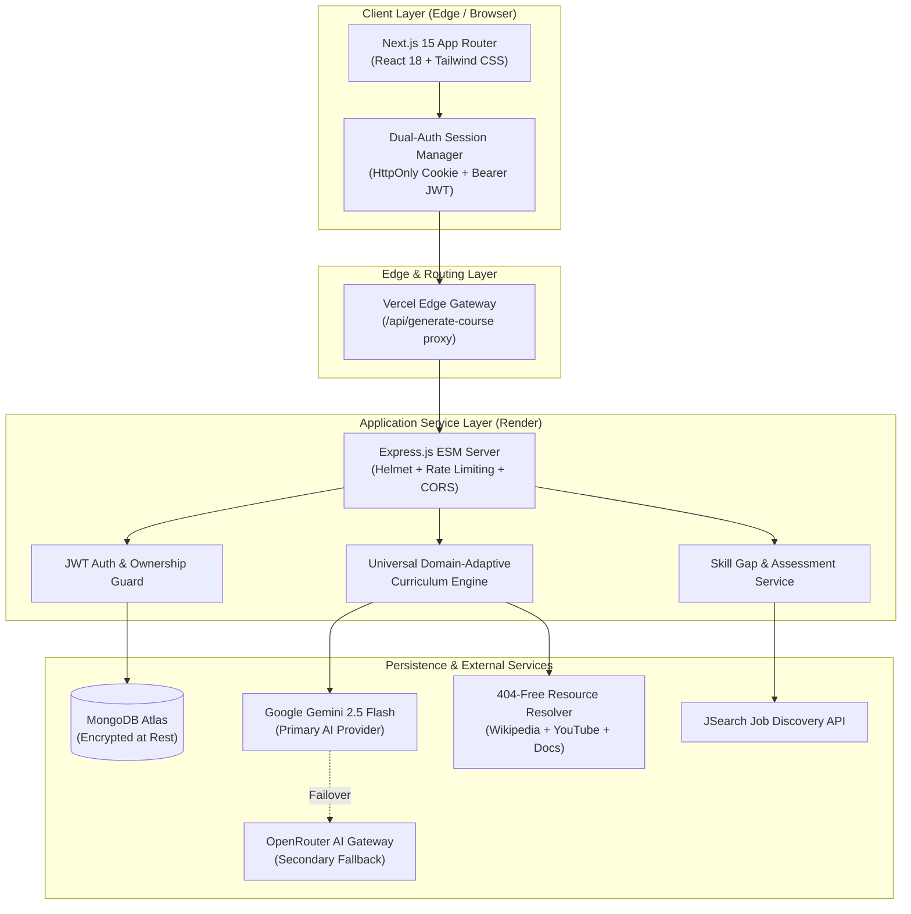

# ⚡ Career Sync — Autonomous Career & Learning Intelligence Platform

> **Production-ready, AI-driven career acceleration engine** combining personalized career trajectory roadmaps, domain-adaptive course generation, ATS resume intelligence, dynamic skill assessments, and real-time job market matching.

[](https://nextjs.org/)
[](https://expressjs.com/)
[](https://www.mongodb.com/atlas)
[](https://deepmind.google/technologies/gemini/)
[](https://career-syncai.vercel.app/home)
[](https://careersync-backend-5oxw.onrender.com/api/health)

---

## 🏛️ System Architecture

Career Sync follows a decoupled monorepo architecture designed for high availability, sub-second edge response times, and multi-provider AI resilience.



---

## 🧠 Key Systems Engineering Decisions

### 1. Universal Domain-Adaptive Curriculum Engine
- **No Hardcoded IT Assumptions**: Unlike traditional course generators that force software engineering terminology (*"Architecture"*, *"Deployment"*, *"Security"*, *"Code"*) onto every topic, Career Sync's curriculum engine operates on universal pedagogical principles.
- **Dynamic Vocabulary & Milestone Derivation**:
  - Arts, Music & Crafts: Generates authentic milestones around composition, color theory, brushwork, mediums, glazing, and textures.
  - Agriculture & Gardening: Generates milestones around soil microbiome, seed germination, sunlight zones, companion planting, and composting.
  - Languages: Organically structures phonetic alphabet/script, vowel modifiers, everyday dialogues, and sentence structure (SOV/SVO).
  - Software & DevOps: Uses real system design, containerization, state management, and CI/CD.
- **Dynamic Module Count**: Derives 4 to 8 milestones organically based on the learner's timeline, daily commitment, and starting level.

### 2. Multi-Provider AI Fallback & Self-Healing JSON
- **Dual-Engine Redundancy**: Primary generation runs through **Google Gemini 2.5 Flash** for deep multilingual fluency and 20–25s response times, with an automatic failover circuit to **OpenRouter / Mixtral-8x22B**.
- **Malformed Response Self-Healing**: Utilizes AST-level `jsonrepair` parsing to automatically correct trailing commas, unescaped quotes, or truncated tokens without crashing the user session.
- **Zero 404-Error Resource Resolution**: Replaces speculative URLs with deterministic Wikipedia and educational YouTube search endpoints, backed by automated HEAD status verification.

### 3. Dual-Layer Cross-Domain Authentication
- **HttpOnly + Bearer Token Sync**: Implements cross-domain cookie authentication (`SameSite=None`, `Secure`) for standard web flows, accompanied by an automatic `Authorization: Bearer` header injector for Safari/iOS privacy sandbox environments.

### 4. Enterprise Monorepo Organization
- Clean workspaces separating Next.js 15 client logic (`apps/web`) from Express.js business pipelines (`apps/api`), with shared scripts and root orchestration.

---

## 📁 Repository Structure

```
Career Sync/
├── apps/
│   ├── api/                          # Express.js REST API & AI Service Pipelines
│   │   ├── config/                   # Target roles, CORS allowlists, URL helpers
│   │   ├── db/                       # MongoDB Atlas connection & Mongoose schemas
│   │   ├── middleware/               # JWT authentication, MongoDB guard, rate limits
│   │   ├── models/                   # Mongoose models (User, Course, Roadmap, etc.)
│   │   ├── routes/                   # REST API routes (auth, roadmaps, courses, skills, resume)
│   │   ├── services/                 # AI roadmap synthesis, resume parsing, job matchers
│   │   ├── utils/                    # Structured logging, token extractors, ownership guards
│   │   ├── package.json              # Backend dependencies & npm scripts
│   │   └── server.js                 # Express server entry point
│   │
│   └── web/                          # Next.js 15 Full-Stack Web Application
│       ├── app/                      # App Router (pages, layouts, API proxy routes)
│       │   ├── (app)/                # Authenticated workspace routes (home, roadmaps, course-generator)
│       │   ├── (marketing)/          # Landing page, authentication, and login flows
│       │   └── api/                  # Server-side proxy endpoints (generate-course proxy)
│       ├── components/               # Modular UI components & design system primitives
│       ├── contexts/                 # React Contexts (AuthContext with token sync)
│       ├── lib/                      # ApiClient, utility functions, type validators
│       ├── middleware.ts             # Route protection & edge session redirection
│       ├── package.json              # Frontend dependencies & npm scripts
│       └── tailwind.config.ts        # Minimalist black & white design tokens
│
├── docs/                             # Engineering documentation & quality audits
│   ├── BACKUP_AND_RECOVERY.md        # RPO/RTO & Disaster recovery specifications
│   ├── ERROR_HANDLING_AND_LOGGING.md # Centralized structured logging architecture
│   ├── SECURITY_AUDIT.md             # OWASP Top 10 compliance audit
│   └── QUALITY_AUDIT.md              # UI/UX, responsive layout, and performance audit
│
├── scripts/                          # Operational CLI utilities
├── deploy.js                         # Unified dual-process development runner
├── DEPLOYMENT_GUIDE.md               # Step-by-step production deployment manual
├── render.yaml                       # Infrastructure-as-Code blueprint for Render
├── package.json                      # Root workspace configuration
└── .gitignore                        # Hardened git exclusions (zero caches or secrets)
```

---

## ⚡ Quickstart & Local Setup

### Prerequisites
- **Node.js**: v20 or newer
- **npm**: v10 or newer
- **MongoDB**: MongoDB Atlas connection URI or local MongoDB instance (`mongodb://localhost:27017/CareerOs`)
- **Google Gemini API Key**: [Google AI Studio](https://aistudio.google.com/)

### 1. Clone & Install
```bash
git clone https://github.com/HarishBonu0/Career_Sync.git
cd Career_Sync
npm run install:all
```

### 2. Environment Configuration

#### Backend: `apps/api/.env`
```env
PORT=5000
NODE_ENV=development
JWT_SECRET=your-random-32-character-secret-key
MONGODB_URI=mongodb+srv://<user>:<password>@cluster.mongodb.net/CareerOs?retryWrites=true&w=majority
GEMINI_API_KEY=your_gemini_api_key_here
CORS_ORIGINS=http://localhost:3000
FRONTEND_URL=http://localhost:3000
```

#### Frontend: `apps/web/.env.local`
```env
NEXT_PUBLIC_API_URL=http://localhost:5000/api
NEXT_PUBLIC_API_BASE_URL=http://localhost:5000/api
GEMINI_API_KEY=your_gemini_api_key_here
OPENROUTER_API_KEY=your_openrouter_api_key_here
```

### 3. Run Development Servers
```bash
# Starts both Backend (port 5000) and Frontend (port 3000) concurrently
npm run dev
```

- **Frontend App**: [http://localhost:3000](http://localhost:3000)
- **API Health Check**: [http://localhost:5000/api/health](http://localhost:5000/api/health)

---

## 📡 REST API Reference

| Endpoint | Method | Description | Auth |
| :--- | :--- | :--- | :---: |
| `/api/health` | `GET` | Service connectivity, database ping, uptime | Public |
| `/api/auth/register` | `POST` | Create a new user account with bcrypt hash | Public |
| `/api/auth/login` | `POST` | Authenticate credentials & issue JWT | Public |
| `/api/auth/me` | `GET` | Retrieve session user profile | Required |
| `/api/courses/generate-questions` | `POST` | Dynamic, topic-authentic question wizard | Public |
| `/api/generate-course` | `POST` | Multi-module AI curriculum synthesis engine | Optional |
| `/api/courses` | `GET` | List user saved courses & completion metrics | Required |
| `/api/roadmaps/generate` | `POST` | Synthesize role-specific career trajectory | Required |
| `/api/roadmaps` | `GET` | Retrieve persisted user roadmaps | Required |
| `/api/resume/analyze` | `POST` | Parse resume document & extract verified talents | Required |
| `/api/skills/questions` | `POST` | Generate adaptive skill assessment test | Required |
| `/api/skills/evaluate` | `POST` | Score test submissions & update skill gaps | Required |

---

## 🚢 Production Deployment

The project is architected for decoupled cloud hosting:
- **Frontend ➔ Vercel**: Production edge hosting with automated CI/CD branch previews.
- **Backend ➔ Render**: Web service running Node.js ESM connected to MongoDB Atlas.

Refer to [DEPLOYMENT_GUIDE.md](./DEPLOYMENT_GUIDE.md) for complete step-by-step instructions.

---

## 📄 License

This project is licensed under the ISC License.
