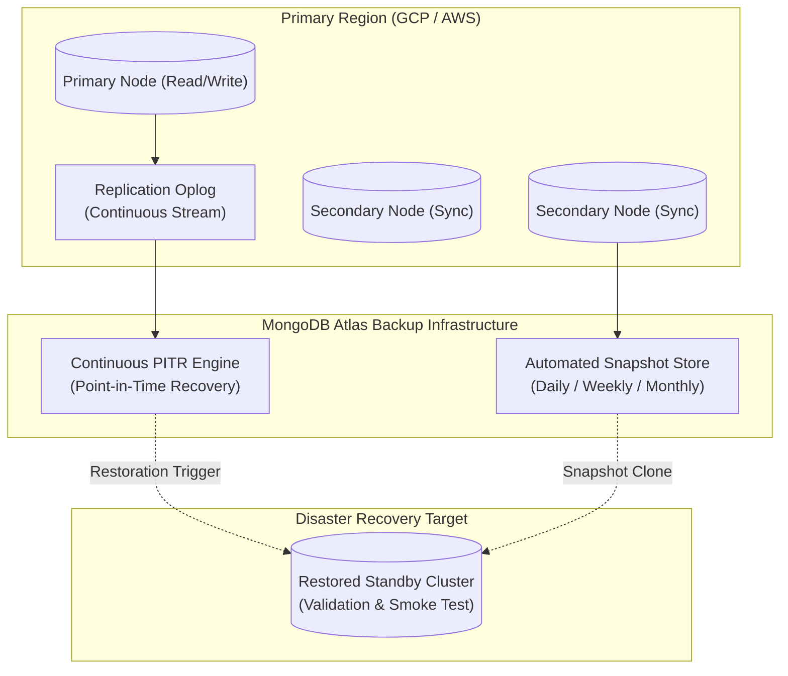

# CAREERSYNC — BACKUP & DISASTER RECOVERY (DR) RUNBOOK

**Date:** November 8, 2026  
**Auditor:** Principal Reliability Engineer & Infrastructure Architect  
**System Under Audit:** CareerSync MongoDB Atlas Database & Storage Architecture  

---

## 1. BACKUP STRATEGY & HOST TOPOLOGY

CareerSync production persistence is hosted on a MongoDB Atlas 3-node replica set (`CareerOs` database) across multiple availability zones.



---

## 2. BACKUP TYPES, FREQUENCY & RETENTION POLICY

| Backup Tier | Mechanism | Frequency | Retention Window | Storage Target |
| :--- | :--- | :--- | :--- | :--- |
| **Continuous PITR** | Oplog tailing | Continuous (real-time) | 7 days rolling | Managed Cloud Storage (Atlas) |
| **Daily Snapshots** | Volume snapshot | Every 24 hours (02:00 UTC) | 7 days | Encrypted Multi-Region S3/GCS |
| **Weekly Archives** | Snapshot promotion | Sundays (03:00 UTC) | 4 weeks | Encrypted Multi-Region S3/GCS |
| **Monthly Archives**| Snapshot promotion | 1st of each month | 12 months | Encrypted Multi-Region S3/GCS |

### Protected Collections & Critical Data Assets
1. `users` — Authentication credentials, bcrypt password hashes, and profile metadata.
2. `roadmaps` — Personalized roadmap trees, milestones, timelines, and progress percentages.
3. `userenrollments` / `courses` — Generated courses, module completions, and study progress.
4. `skillevaluations` — Generated evaluation question sets, user submissions, scores, and radar charts.
5. `skillprofiles` — Inferred skill levels, priority skill gaps, and resume parsing insights.

---

## 3. RPO & RTO RECOVERY SERVICE LEVEL OBJECTIVES (SLOs)

- **Recovery Point Objective (RPO):** `<= 15 minutes`  
  *Meaning:* In the event of catastrophic data corruption or cluster failure, no more than 15 minutes of user progress will be lost.
- **Recovery Time Objective (RTO):** `<= 30 minutes`  
  *Meaning:* Full application functionality will be restored to healthy operational status within 30 minutes of incident declaration.

---

## 4. STEP-BY-STEP DISASTER RECOVERY RUNBOOK

### Step 1: Incident Declaration & Assessment
1. Confirm that a critical persistence outage or unrecoverable data corruption has occurred.
2. Freeze non-read API traffic by setting `MAINTENANCE_MODE=true` in Render environment settings if partial corruption is spreading.
3. Identify the target timestamp $T_{recover}$ immediately preceding the corruption event.

### Step 2: Trigger Atlas Point-In-Time Restoration
1. Log in to the [MongoDB Atlas Console](https://cloud.mongodb.com).
2. Navigate to **Deployment** > **Database** > Target Cluster (`CareerOs`).
3. Click **Backup** > **Restore**.
4. Select **Point-in-Time Restore**.
5. Input the exact UTC timestamp $T_{recover}$.
6. Select destination: **Restore to a New Cluster** named `CareerOs-DR-Restored`.
7. Click **Confirm and Restore**. Atlas provisions the new cluster and replays oplog entries up to $T_{recover}$.

### Step 3: Verification & Data Smoke Test
Before routing user traffic to the restored cluster:
1. Obtain the new connection URI: `mongodb+srv://<user>:<password>@careeros-dr-restored...mongodb.net/CareerOs`.
2. Connect from an isolated staging worker and execute data validation queries:
   ```javascript
   // Verify user count and latest records
   db.users.countDocuments();
   db.roadmaps.find().sort({ createdAt: -1 }).limit(5);
   db.skillevaluations.find().sort({ createdAt: -1 }).limit(5);
   ```
3. Verify referential integrity between `users` and `userenrollments`.

### Step 4: Failover Configuration Update
1. Update `MONGODB_URI` in Render Web Service environment variables to point to `CareerOs-DR-Restored`.
2. Trigger an immediate redeployment of `apps/api`.
3. Verify `/api/health` returns `mongodbConfigured: true` and `status: "OK"`.
4. Remove `MAINTENANCE_MODE` flag to resume client traffic.

### Step 5: Post-Mortem & Incident Logging
1. Document the incident cause, duration, and data discrepancy in the engineering post-mortem registry.
2. Archive the decommissioned corrupted cluster for 14 days before deletion.

