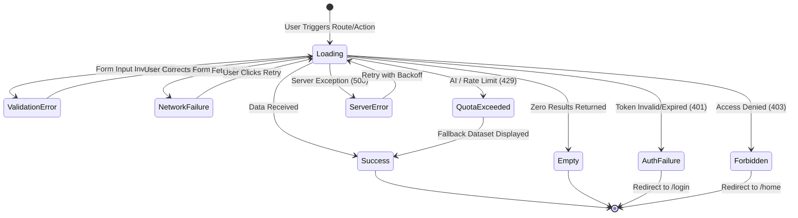

# CAREERSYNC — ERROR HANDLING & CENTRALIZED LOGGING ARCHITECTURE

**Date:** November 8, 2026  
**Auditor:** Principal Reliability Engineer & Site Reliability Engineering (SRE)  
**System Under Audit:** CareerSync Platform (`apps/api` and `apps/web`)  

---

## 1. CENTRALIZED LOGGING SPECIFICATION

CareerSync employs structured JSON logging across all backend services (`apps/api/utils/logger.js`) to provide observability, facilitate distributed tracing, and enable rapid root-cause analysis (RCA).

### Supported Log Levels

| Level | Severity Code | Semantic Purpose | Example Operational Event |
| :--- | :--- | :--- | :--- |
| **DEBUG** | 10 | Detailed debugging data for local development | Cache hit/miss, query execution timings |
| **INFO** | 20 | Normal operational milestones | Server startup, successful user auth, job search dispatched |
| **WARN** | 30 | Transient or recoverable anomalies | Gemini rate limit fallback, non-critical parameter omission |
| **ERROR** | 40 | Operation failure affecting a user request | Database query exception, external API timeout |
| **FATAL** | 50 | Unrecoverable service failure causing shutdown | MongoDB connection loss, missing critical environment variables |

### Structured Log Schema

All structured log records follow this standardized schema:

```json
{
  "timestamp": "2026-11-08T06:40:11.125Z",
  "level": "INFO",
  "environment": "production",
  "service": "careersync-api",
  "requestId": "req_8f9a2b1c4d",
  "operation": "AUTH_REGISTER",
  "userId": "6af019f3be381b99cbd069f0",
  "durationMs": 142,
  "context": {
    "emailDomain": "careersync.test",
    "ip": "10.0.4.12"
  }
}
```

---

## 2. SECRETS HYGIENE & LOG SANITIZATION

To maintain compliance with privacy regulations (GDPR, CCPA) and security best practices:

1. **Strictly Masked Fields:**
   - User passwords and password hashes (`password`, `currentPassword`, `newPassword`)
   - Bearer and session tokens (`Career_Sync_token`, `authorization`, `refreshToken`)
   - Third-party API keys (`GEMINI_API_KEY`, `RAPIDAPI_KEY`, `OPENROUTER_API_KEY`)
   - Document contents (Raw resume text, extracted PII)
2. **Sanitization Filter:**
   The backend logging utility scrubs incoming objects recursively before writing to stdout. Key names matching `/token|secret|password|key|cookie|auth|resume/i` are replaced with `"[REDACTED]"`.

---

## 3. HTTP STATUS CODE ALIGNMENT & ERROR CLASSIFICATION

The API strictly adheres to RESTful error conventions, eliminating ambiguous 200 responses for failed operations.

| Status Code | Standard Usage | CareerSync Implementation Example |
| :--- | :--- | :--- |
| **400 Bad Request** | Schema/validation failures | Missing required fields (`topic`, `email`, `targetRole`) |
| **401 Unauthorized** | Missing or expired credentials | Invalid JWT, expired session cookie |
| **403 Forbidden** | Authorization failure | Attempting to access another user's private roadmap/profile |
| **404 Not Found** | Resource does not exist | Invalid roadmap ID or course slug |
| **409 Conflict** | Duplicate resource | Email already registered during signup |
| **422 Unprocessable** | Semantic validation errors | Resume file uploaded in unsupported binary format |
| **429 Too Many Requests** | Rate limit or AI quota exhausted | Upstream Gemini API 429 quota exhaustion |
| **500 Internal Error** | Unhandled server exception | Database query exception (masked in production) |
| **503 Service Unavailable**| External integration unconfigured | RapidAPI or Gemini API key missing on host |

---

## 4. FRONTEND STATE MATRIX & ERROR BOUNDARIES

The frontend handles all ten essential operational states cleanly without crashing the UI:



### Production Error Boundary
The Next.js root layout and sub-routes are wrapped in React Error Boundaries (`error.tsx` and `global-error.tsx`). If an unexpected rendering runtime error occurs:
- The error boundary catches the exception.
- Stack traces are logged to client telemetry but hidden from the user.
- A clean, accessible fallback card is presented: *"Something went wrong. Return to Dashboard or Try Again."*

