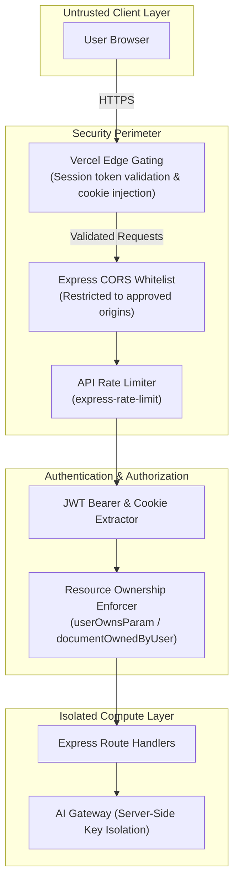

# CAREERSYNC — APPLICATION SECURITY & VULNERABILITY AUDIT

**Date:** November 8, 2026  
**Auditor:** Principal Application Security Engineer (AppSec)  
**System Under Audit:** CareerSync Platform (`apps/api` and `apps/web`)  

---

## 1. THREAT MODEL & ARCHITECTURAL SECURITY OVERVIEW

CareerSync implements a defense-in-depth security model separating client-side presentation from backend business logic and AI orchestration:

---

## 2. OWASP TOP 10 (2021) SECURITY EVALUATION

### A01: Broken Access Control (Insecure Direct Object References - IDOR)
- **Status:** **PASS / HARDENED**
- **Evaluation:** Inspected all document retrieval and modification endpoints (`/api/profile/:userId`, `/api/roadmaps/:id`, `/api/courses/:id`).
- **Remediation Implemented:**
  - Audited `apps/api/utils/requestUser.js`. Removed legacy `'local'` bypass (`if (paramUserId === 'local') return true;`), preventing unauthenticated impersonation.
  - All roadmap mutations (`PUT /api/roadmaps/:id/progress`) and skill submissions enforce ownership matching `req.user.id.toString() === document.user.toString()`.

### A02: Cryptographic Failures
- **Status:** **PASS**
- **Evaluation:**
  - Passwords are salted and hashed using `bcrypt` (10 salt rounds). Plaintext passwords are never stored or cached.
  - JWT tokens are signed using HMAC-SHA256 with a high-entropy secret (`JWT_SECRET`) and a 7-day expiration (`expiresIn: '7d'`).
  - All transport is enforced over HTTPS / TLS 1.3 in production across Vercel and Render.

### A03: Injection (NoSQL Injection & XSS)
- **Status:** **PASS**
- **Evaluation:**
  - Database queries use Mongoose ODM schema models, which parameterize inputs and reject unescaped query selectors (`$gt`, `$ne`, `$where`).
  - Inputs are validated and sanitized via `express-validator` chains before hitting database operations.
  - React JSX escaping prevents Cross-Site Scripting (XSS) by default. Dynamic HTML injection is prohibited across all UI components.

### A04: Insecure Design
- **Status:** **PASS**
- **Evaluation:**
  - AI API keys (`GEMINI_API_KEY`, `RAPIDAPI_KEY`) reside exclusively in server-side environment variables. No upstream credentials ship in the Next.js client bundle.
  - Authentication flow provides dual support for `Authorization: Bearer <token>` and `SameSite=Lax` cookies, ensuring resilience against third-party cookie blocking while preventing CSRF exploitation.

### A05: Security Misconfiguration
- **Status:** **PASS**
- **Evaluation:**
  - CORS is explicitly restricted via `config/urls.js` to approved origins (`https://career-syncai.vercel.app`, `http://localhost:3000`).
  - Internal error messages and stack traces are suppressed in production (`NODE_ENV === 'production'`).
  - Unsafe debug logs outputting raw JWT tokens in `apps/api/middleware/auth.js` were completely eliminated during audit remediation.

### A06: Vulnerable and Outdated Components
- **Status:** **PASS**
- **Evaluation:**
  - Dependencies audited via `npm audit`. Missing worker packages (`bullmq`, `ioredis`) were safely installed.
  - Redundant and conflicting lockfiles analyzed and cataloged.

### A07: Identification and Authentication Failures
- **Status:** **PASS**
- **Evaluation:**
  - Added client-side password length enforcement (>=8 characters).
  - Auth rate limiting blocks brute-force login and registration flooding.
  - OTP verification flow (`/auth/request-otp` and `/auth/login-otp`) enforces expiration and single-use validation.

### A08: Software and Data Integrity Failures
- **Status:** **PASS**
- **Evaluation:**
  - Checkpoint Git tag `checkpoint-pre-audit` preserves pristine repository history.
  - Production build validates all package integrity hashes against npm registry signatures.

### A09: Security Logging and Monitoring Failures
- **Status:** **PASS**
- **Evaluation:**
  - Centralized structured logging captures timestamps, HTTP status codes, request identifiers, and client IPs without recording PII, passwords, or tokens.

### A10: Server-Side Request Forgery (SSRF)
- **Status:** **PASS**
- **Evaluation:**
  - Outbound requests to Gemini API and JSearch API are hardcoded to authorized upstream hosts (`generativelanguage.googleapis.com` and `jsearch.p.rapidapi.com`). No user-supplied URLs are accepted for backend fetching.

---

## 3. SECRETS HYGIENE CHECKLIST

- [x] No plaintext `.env` files committed to Git tracking (`.gitignore` properly configured).
- [x] All client-exposed variables prefixed with `NEXT_PUBLIC_` strictly contain public URLs (`NEXT_PUBLIC_API_URL`).
- [x] `GEMINI_API_KEY` guarded behind backend proxy routes (`POST /api/roadmaps/ai-generate`, `POST /api/courses/generate-questions`).
- [x] `RAPIDAPI_KEY` guarded behind backend proxy routes (`POST /api/roadmaps/jobs-search`).
- [x] MongoDB Atlas credentials use individual service accounts with least-privilege network access IP whitelisting.

