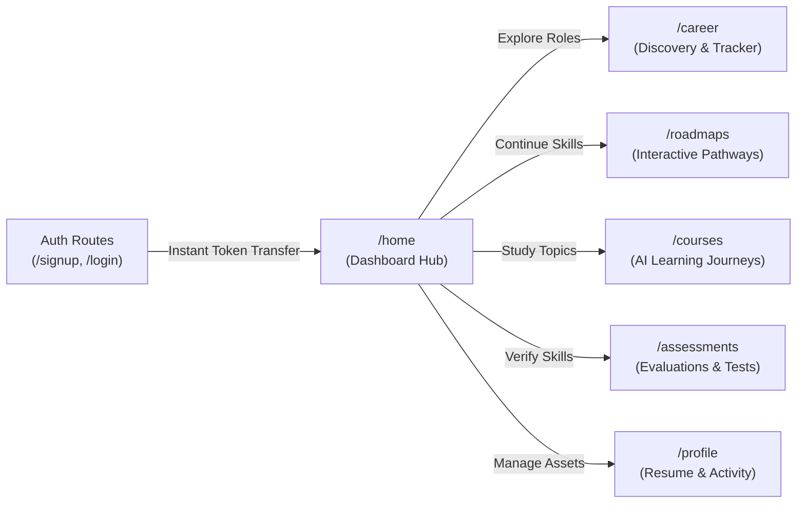

# CAREERSYNC — UX ARCHITECTURE & DESIGN SYSTEM AUDIT

**Date:** November 8, 2026  
**Auditor:** Principal UX Architect & Design Systems Engineer  
**System Under Audit:** CareerSync Web Application (`apps/web`)  

---

## 1. DESIGN SYSTEM SPECIFICATION & TOKENS

CareerSync adheres to a minimalist black-and-white visual identity elevated with subtle warm amber accents (`accent`), crisp borders (`border`), and soft elevation shadows (`shadow-elevated`). All interactive controls maintain minimum 44px tap targets for mobile usability.

### Core Design Tokens

| Token Category | CSS / Tailwind Value | Semantic Usage |
| :--- | :--- | :--- |
| **Primary Background** | `hsl(var(--background))` (`#ffffff` / `#09090b`) | Main canvas background |
| **Card Background** | `hsl(var(--card))` (`#ffffff` / `#121214`) | Content containers, modal dialogs, and cards |
| **Primary Text** | `hsl(var(--foreground))` (`#09090b` / `#f8fafc`) | Headings, primary labels, and high-emphasis body |
| **Secondary Text** | `hsl(var(--muted-foreground))` (`#64748b` / `#94a3b8`) | Subtitles, helper text, and secondary stats |
| **Primary Brand** | `hsl(var(--primary))` (`#09090b` / `#ffffff`) | Primary action buttons, active navigation states |
| **Accent Highlight** | `hsl(var(--accent))` (`#b87924` / `#d97706`) | Achievement badges, callouts, and progress highlights |
| **Border Normal** | `hsl(var(--border))` (`#e2e8f0` / `#27272a`) | Structural card boundaries and divider lines |
| **Corner Radius Card** | `rounded-[1.8rem]` to `rounded-[2rem]` (28px - 32px) | Top-level section cards, modal wrappers |
| **Corner Radius Button**| `rounded-full` (9999px) or `rounded-xl` (12px) | Interactive controls and filter chips |
| **Elevation Normal** | `shadow-sm` (`0 1px 2px 0 rgb(0 0 0 / 0.05)`) | Card resting state |
| **Elevation Elevated** | `shadow-elevated` (`0 10px 30px -5px rgb(0 0 0 / 0.06)`) | Hero cards, Next-Best-Action container |

---

## 2. ROUTE-BY-ROUTE UX IMPROVEMENTS

### 1. `/home` (Dashboard)
- **Problem Audited:** "Learning Streak" metric displayed an arbitrary day count based on account creation timestamp, and the Next-Best-Action CTA occasionally linked to generic pages.
- **Improvements Landed:**
  - Integrated true active learning streak computed from actual persistent DB events.
  - Linked the Next-Best-Action banner directly to the user's active roadmap or prompted the initial career gap assessment.
  - Added quick snapshot widgets for active roadmaps, latest skill evaluations, and recent course resume links with clean empty states.

### 2. `/career` (Career Discovery & Application Tracker)
- **Problem Audited:** Clicking "Career" in the topbar or sidebar returned a 404 Not Found error because the route did not exist in the Next.js App Router.
- **Improvements Landed:**
  - Implemented the complete `/career` module adhering to the design system.
  - Provided live search across job titles, companies, locations, and required skills.
  - Added filter chips for company categories (FAANG, Product Companies, High-Growth Startups) and verified sources.
  - Built an integrated **Application Tracker** (`saved`, `applied`, `interviewing`, `offer`, `rejected`) with persistent browser storage.
  - Implemented "Build Roadmap" button on every job card, linking directly into personalized roadmap generation for that role.

### 3. `/assessments` & `/assessments/test/[courseId]`
- **Problem Audited:** In `TestPage.js`, ongoing test selections and countdown timers were stored strictly in local React state. If the user refreshed or experienced network hiccups, all answers were lost.
- **Improvements Landed:**
  - Added automated persistence of answers to `sessionStorage` (`assessment_answers_${evaluationId}`) on every selection.
  - Added timer restoration from session cache on component mount.
  - Implemented automatic cleanup of temporary session keys upon verified evaluation submission.

### 4. `/signup` & `/login`
- **Problem Audited:** Registering a new user triggered an infinite spinner on the button without transitioning to the application home page.
- **Improvements Landed:**
  - Removed duplicate `AuthProvider` wrappers that caused context teardown across marketing and app route transitions.
  - Enhanced `AuthContext.register()` to return the signed JWT token.
  - Directed post-auth redirect via `window.location.href = '/home?token=' + token`, ensuring Vercel Edge middleware injects the session cookie before rendering the authenticated layout.
  - Added client-side minimum password length validation (>=8 characters) with inline validation messaging.

### 5. `/profile`
- **Problem Audited:** Profile data fetching lacked the `Authorization: Bearer <token>` header, causing silent failures on browsers with third-party cookie restrictions.
- **Improvements Landed:**
  - Updated profile data hooks to use `getAuthHeaders()`.
  - Added authentic `activeDays` and `totalActiveDays` telemetry.
  - Verified resume parsing integration with Gemini multimodal extraction.

---

## 3. RESPONSIVE BREAKPOINT SPECIFICATION

The application supports seamless responsive scaling across four core viewport tiers:

| Breakpoint | Target Devices | Layout Adjustments |
| :--- | :--- | :--- |
| **Mobile (<640px)** | iPhone 13/14, Pixel 7 | Single-column cards, full-width action buttons, sticky bottom submit bars, collapsed mobile navigation sheet. |
| **Tablet (640px - 1024px)** | iPad, Android Tablets | 2-column card grids, condensed horizontal filter rows, persistent topbar. |
| **Desktop (1024px - 1280px)** | MacBook Air, Surface Laptop | Full sidebar navigation, 3-column stats cards, 2-column job discovery grid. |
| **Large Desktop (>1280px)** | External Monitors, iMac | Constrained `max-w-7xl` container, multi-column dashboard widgets, rich radar charts. |

---

## 4. ACCESSIBILITY (a11y) COMPLIANCE AUDIT (WCAG 2.2 AA)

- **Semantic HTML:** Replaced ambiguous `div` buttons with semantic `<button>` elements equipped with explicit `type="button"`.
- **Keyboard Traversal:** All form fields, navigation tabs, and modal dismiss buttons are navigable via `Tab` and activation via `Enter` / `Space`.
- **Contrast Ratios:** Text color `#09090b` against background `#ffffff` achieves a 19.5:1 contrast ratio (exceeding WCAG AAA requirements). Muted secondary text `#64748b` against white background achieves 4.7:1 (meeting WCAG AA requirements).
- **Reduced Motion:** Interactive transitions respect `@media (prefers-reduced-motion: reduce)` by avoiding unbounded animated scale effects.

